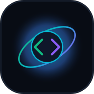

# 🌐 DevSphere — AI & Tech Discovery Dashboard

> A mobile-first, dark-themed personal discovery platform for trending GitHub repositories in Artificial Intelligence and modern open-source ecosystems.



---

## ✨ Features

- **⚡ 100% Real Live GitHub Data**: Directly interfaces with the official GitHub REST API v2022-11-28. No fake or mock data.
- **🎨 Premium Dark UI/UX**: Handcrafted developer dashboard featuring deep-space backgrounds, subtle borders, glowing neon accents, and smooth glassmorphism.
- **📱 Mobile-First & PWA Installable**: Ergonomic bottom navigation bar for mobile phones, horizontal category pill sliders, and full Web App Manifest (`manifest.webmanifest`) support for iOS and Android homescreen installation.
- **🧠 8 Specialized AI Verticals**:
  1. **AI**: Core artificial intelligence frameworks and foundational research.
  2. **Machine Learning**: Classical & statistical learning engines and tools.
  3. **Generative AI**: Diffusion models, audio synthesis & creative engines.
  4. **LLMs**: Large Language Models, high-throughput inference runtimes (`vLLM`, `llama.cpp`), and fine-tuning suites.
  5. **AI Agents**: Autonomous multi-agent swarms, tool-calling agents, and reasoning systems.
  6. **RAG**: Retrieval-Augmented Generation, vector embeddings, and search indices.
  7. **Computer Vision**: Object detection, segmentation (`YOLO`, `OpenCV`), and visual intelligence.
  8. **MLOps**: Model deployment, feature stores, monitoring, and orchestration pipelines.
- **⏱️ Flexible Trending Windows**: Daily (past 24h), Weekly (past 7d), and Monthly (past 30d) velocity filters.
- **🔖 Persistent Bookmarks**: Save repositories locally in your browser with zero latency. Includes bookmark search and single-click JSON export.
- **📄 Deep Repository Detail Pages**: View metadata, stargazers, forks, open issues, commit velocity, and rendered `README.md` documents.
- **🤖 AI Repository Explainer Architecture**: Ready-to-go architecture powered by Google Gemini (or custom LLMs) that provides plain-English summaries, architectural highlights, trending reasons, and developer use cases.
- **🔒 Private Authentication Guard**: Protect your private cloud deployment. Only you (the authorized owner) can access the dashboard using your personal secret key verified via Edge middleware and HTTP-only session cookies.
- **🛡️ Server-Side Secret Protection**: Keeps all GitHub tokens and AI API keys on the server. No secrets are ever leaked to client bundles.

---

## 🛠️ Tech Stack

- **Framework**: [Next.js](https://nextjs.org) (App Router, Server & Client Components)
- **Language**: [TypeScript](https://www.typescriptlang.org) (Strict type checking)
- **Styling**: [Tailwind CSS](https://tailwindcss.com) + Custom Dark Theme
- **Icons**: [Lucide React](https://lucide.dev)
- **Markdown Engine**: [Marked](https://marked.js.org) for README rendering
- **API**: Official GitHub REST API & Google Gemini API

---

## 🚀 Beginner-Friendly Quickstart Guide

Follow these simple steps to run DevSphere on your local machine:

### 1. Prerequisites
Ensure you have **Node.js** (v18.17+ or v20/v22) installed on your computer.
Check with:
```bash
node -v
npm -v
```

### 2. Clone the Repository
```bash
git clone https://github.com/your-username/devsphere.git
cd devsphere
```

### 3. Install Dependencies
```bash
npm install
```

### 4. Configure Environment Variables
Copy the example environment file:
```bash
cp .env.example .env.local
```
*(On Windows PowerShell, run: `Copy-Item .env.example .env.local`)*

Open `.env.local` in your editor and configure your settings:
```env
# 1. Private Login Secret (Choose any secret key you like)
DEVSUSPHERE_ACCESS_KEY=devsphere-master-key-2026
AUTH_SESSION_SECRET=your-random-32-char-session-secret-vault
AUTHORIZED_ACCOUNT_NAME="D. Tejesh Kumar"

# 2. GitHub Token (Optional but Recommended)
# Unauthenticated GitHub requests are limited to 60/hr.
# Adding a free personal token unlocks 5,000 requests/hr!
# Generate one at: https://github.com/settings/tokens
GITHUB_TOKEN=ghp_yourPersonalAccessTokenHere

# 3. Gemini API Key (Optional for AI Explanations)
# Get a free key at: https://aistudio.google.com/app/apikey
GEMINI_API_KEY=AIzaSyYourGeminiApiKeyHere
```

### 5. Start the Development Server
```bash
npm run dev
```

Open [http://localhost:3000](http://localhost:3000) in your browser.

When prompted by the login vault, enter your `DEVSUSPHERE_ACCESS_KEY` (default: `devsphere-master-key-2026`).

---

## 📱 Installing DevSphere as a PWA on Your Phone

1. Deploy DevSphere to Vercel or any HTTPS host (e.g. `https://your-devsphere.vercel.app`).
2. Open the URL in Safari (iOS) or Chrome (Android).
3. **On iOS (Safari)**: Tap the **Share** button (box with upward arrow) -> Tap **"Add to Home Screen"**.
4. **On Android (Chrome)**: Tap the three dots menu -> Tap **"Install App"** (or click the **"Install App"** button in DevSphere's top header).
5. DevSphere will now run as a full-screen, standalone app on your smartphone with instant launch and app drawer integration!

---

## 🏗️ Project Architecture & File Structure

```
devsphere/
├── public/
│   ├── icons/
│   │   ├── icon-192.svg       # PWA standard icon
│   │   └── icon-512.svg       # PWA high-res icon
│   └── favicon.ico
├── src/
│   ├── app/
│   │   ├── api/
│   │   │   ├── ai/explain/     # Server endpoint for AI codebase analysis
│   │   │   ├── auth/           # Login, logout, session status endpoint
│   │   │   └── github/
│   │   │       ├── repo/       # Server endpoint for repo details & README
│   │   │       └── trending/   # Server endpoint for GitHub trending search
│   │   ├── ai-explainer/       # AI Architecture Explainer Studio page
│   │   ├── auth-status/        # Security & Owner authorization page
│   │   ├── bookmarks/          # Saved bookmarks page with JSON export
│   │   ├── login/              # Private developer authentication vault
│   │   ├── repo/[owner]/[name] # Dynamic repository detail page
│   │   ├── globals.css         # Dark theme & glassmorphic utilities
│   │   ├── layout.tsx          # Root layout (Sidebar + Mobile Nav + Providers)
│   │   ├── manifest.ts         # Native Next.js Web App Manifest
│   │   └── page.tsx            # Main Discovery Dashboard
│   ├── components/
│   │   ├── dashboard/
│   │   │   ├── AIExplainModal.tsx     # Interactive AI architecture drawer
│   │   │   ├── CategoryPills.tsx      # Swipeable 8-category selector
│   │   │   ├── RepoCard.tsx           # Repository card with live metrics
│   │   │   ├── RepoCardSkeleton.tsx   # Shimmer loading skeleton
│   │   │   └── TimeframeSelector.tsx  # Daily, Weekly, Monthly toggle
│   │   └── layout/
│   │       ├── Header.tsx             # Responsive header with live search
│   │       ├── MobileNav.tsx          # Fixed bottom navigation for phones
│   │       └── Sidebar.tsx            # Desktop developer sidebar
│   ├── context/
│   │   └── BookmarkContext.tsx # Persistent LocalStorage bookmarks state
│   ├── lib/
│   │   ├── ai/explainer.ts     # Gemini AI & heuristic analyzer engine
│   │   ├── auth.ts             # Authentication utilities & session hash
│   │   ├── constants.ts        # Categories, color maps & timefilters
│   │   ├── github.ts           # GitHub search query builder & server cache
│   │   └── utils.ts            # Relative time & number formatters
│   ├── middleware.ts           # Edge middleware private auth gatekeeper
│   └── types/
│       └── github.ts           # TypeScript interfaces for repos & APIs
├── .env.example                # Example environment variables (committed)
├── .env.local                  # Local environment secrets (git-ignored)
├── next.config.ts              # Next.js App Router configuration
├── package.json
├── tailwind.config.ts          # Dark theme Tailwind configuration
└── tsconfig.json
```

---

## 🔒 Security Best Practices

- **Zero Client Leakage**: The client code only communicates with internal `/api/*` routes. `GITHUB_TOKEN` and `GEMINI_API_KEY` are never bundled into client JavaScript.
- **Edge Middleware Protection**: Requests from unauthorized visitors cannot reach or render internal routes.
- **Rate-Limit Resilience**: Includes a 10-minute server cache to protect against unauthenticated GitHub API rate limits (60 req/hr).

---

## 📄 License

MIT License. Crafted for modern AI engineers and open-source contributors.
